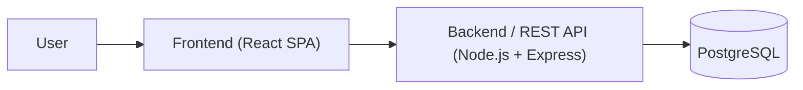
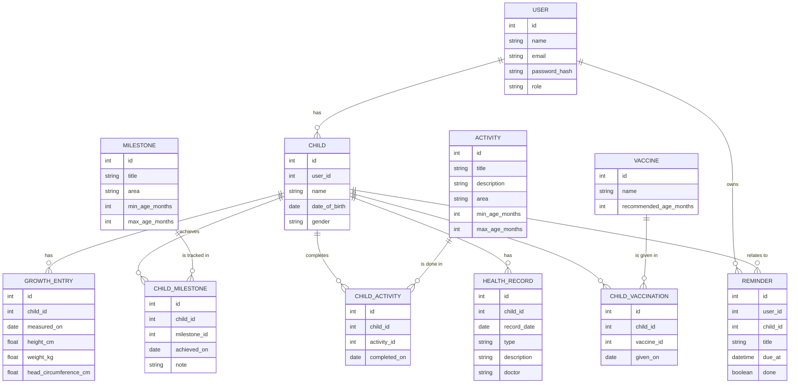
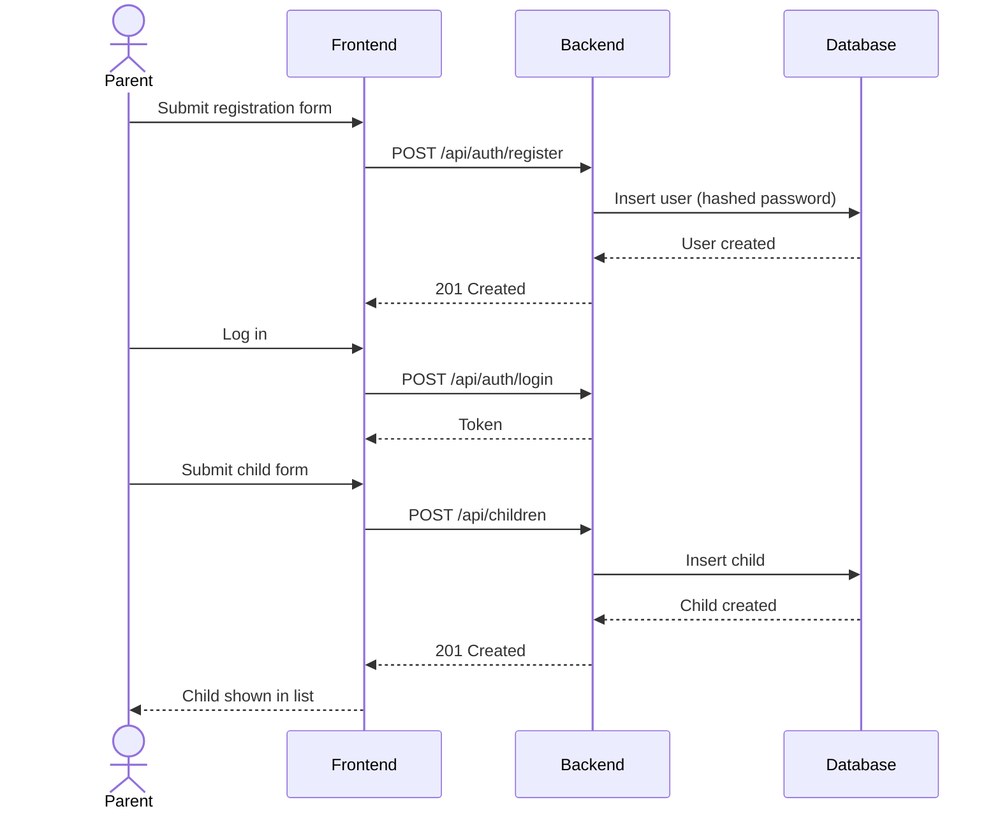
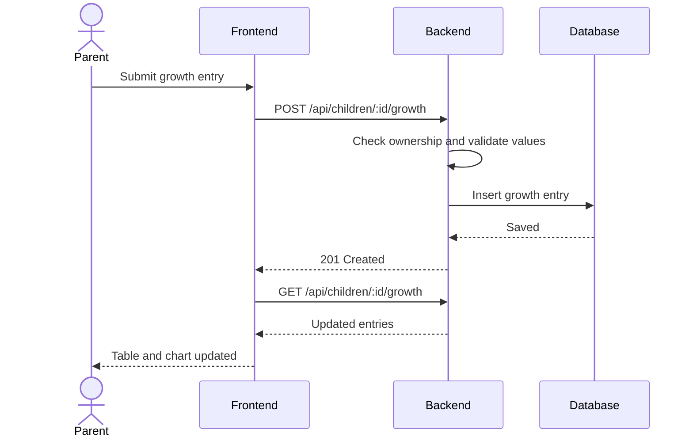
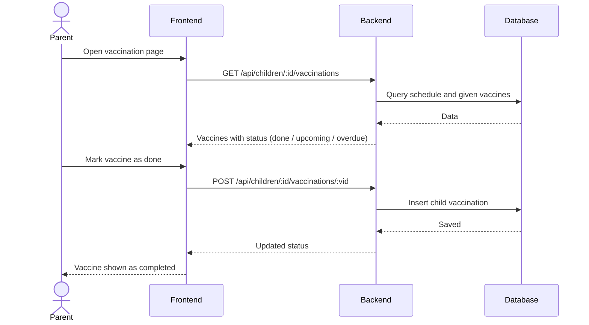

# Software Design Document (SDD)

**Team name:** Child Development Platform Team  
**Version:** ☑ First version (Week 6) ☐ Final (Week 10)  
**Last updated:** 2026-10-22

---

## 1. Architecture Overview

The system is a three-tier web application: a single-page frontend talks to a REST API backend, which stores data in a relational database. The backend is organized in layers (routes, services, data access) with one set of components per module.

### Technology Stack

| Layer | Technology |
|---|---|
| Frontend | React, React Router, Chart.js |
| Backend | Node.js, Express, JWT authentication |
| Database | PostgreSQL |
| Testing | Jest (unit/API), Playwright (end-to-end) |
| CI | GitHub Actions |

---

## 2. Module Design

| Module | Main components | Implements requirements |
|---|---|---|
| M1 – Authentication & User Accounts | `AuthController`, `AuthService`, `User` model, Login/Register pages | FR-M1-01 … FR-M1-06 |
| M2 – Child Profiles | `ChildController`, `ChildService`, `Child` model, ChildList/ChildForm pages | FR-M2-01 … FR-M2-05 |
| M3 – Growth Tracking | `GrowthController`, `GrowthService`, `GrowthEntry` model, GrowthChart page | FR-M3-01 … FR-M3-06 |
| M4 – Developmental Milestones | `MilestoneController`, `MilestoneService`, `Milestone` and `ChildMilestone` models, MilestoneChecklist page | FR-M4-01 … FR-M4-06 |
| M5 – Activities & Recommendations | `ActivityController`, `RecommendationService`, `Activity` model, ActivityList page | FR-M5-01 … FR-M5-05 |
| M6 – Health Records & Vaccinations | `HealthRecordController`, `VaccinationService`, `HealthRecord`, `Vaccine` and `ChildVaccination` models, Health/Vaccination pages | FR-M6-01 … FR-M6-06 |
| M7 – Reminders & Notifications | `ReminderController`, `ReminderService`, `Reminder` model, scheduled job, NotificationList component | FR-M7-01 … FR-M7-04 |
| M8 – Dashboard & Reports | `DashboardController`, `ReportService`, Dashboard and Report pages | FR-M8-01 … FR-M8-05 |

---

## 3. Data Model

---

## 4. API / Interfaces

| Method | Endpoint | Description | Module |
|---|---|---|---|
| POST | `/api/auth/register` | Register a new user | M1 |
| POST | `/api/auth/login` | Log in and receive a token | M1 |
| GET | `/api/children` | List the logged-in user's children | M2 |
| POST | `/api/children` | Create a child profile | M2 |
| PUT | `/api/children/:id` | Update a child profile | M2 |
| DELETE | `/api/children/:id` | Delete a child profile | M2 |
| GET | `/api/children/:id/growth` | List growth entries | M3 |
| POST | `/api/children/:id/growth` | Add a growth entry | M3 |
| GET | `/api/children/:id/milestones` | List milestones with achievement status | M4 |
| POST | `/api/children/:id/milestones/:mid` | Mark a milestone as achieved | M4 |
| GET | `/api/children/:id/activities` | Get age-appropriate activities | M5 |
| GET | `/api/children/:id/health-records` | List health records | M6 |
| POST | `/api/children/:id/health-records` | Add a health record | M6 |
| GET | `/api/children/:id/vaccinations` | List vaccinations with status | M6 |
| POST | `/api/children/:id/vaccinations/:vid` | Mark a vaccination as done | M6 |
| GET | `/api/reminders` | List the user's reminders | M7 |
| POST | `/api/reminders` | Create a reminder | M7 |
| GET | `/api/children/:id/dashboard` | Dashboard summary for a child | M8 |
| GET | `/api/children/:id/report` | Generate a summary report | M8 |

---

## 5. Critical Flows

### Flow 1: Register, log in and add a child

### Flow 2: Record a growth measurement

### Flow 3: Track a vaccination

---

## 6. User Interface

| Screen | Image | Module |
|---|---|---|
| Login / Register | `docs/img/ui-login.png` | M1 |
| Child list and child form | `docs/img/ui-children.png` | M2 |
| Growth chart | `docs/img/ui-growth.png` | M3 |
| Milestone checklist | `docs/img/ui-milestones.png` | M4 |
| Vaccination schedule | `docs/img/ui-vaccinations.png` | M6 |
| Dashboard | `docs/img/ui-dashboard.png` | M8 |

---

## 7. Change Log

| Date | Change | By |
|---|---|---|
| 2026-10-22 | First version | Team |
