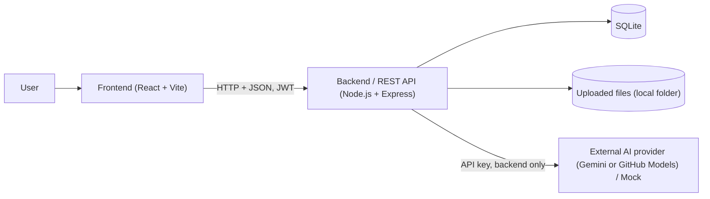
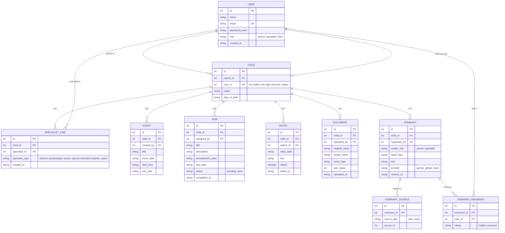
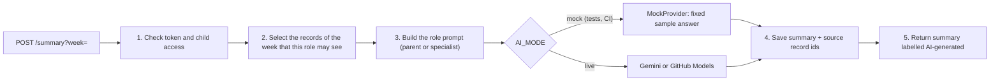
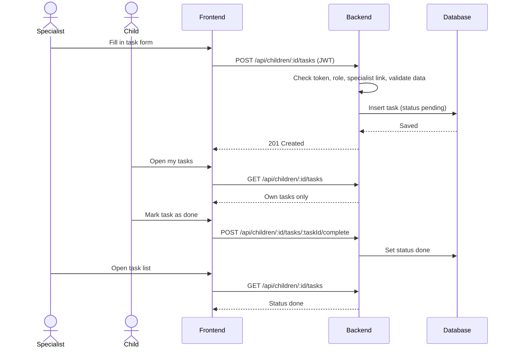
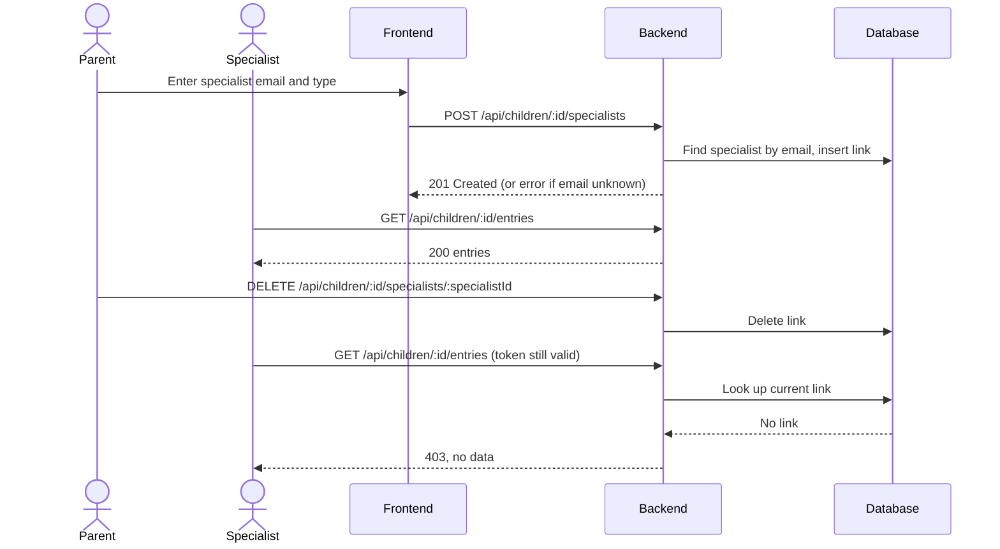
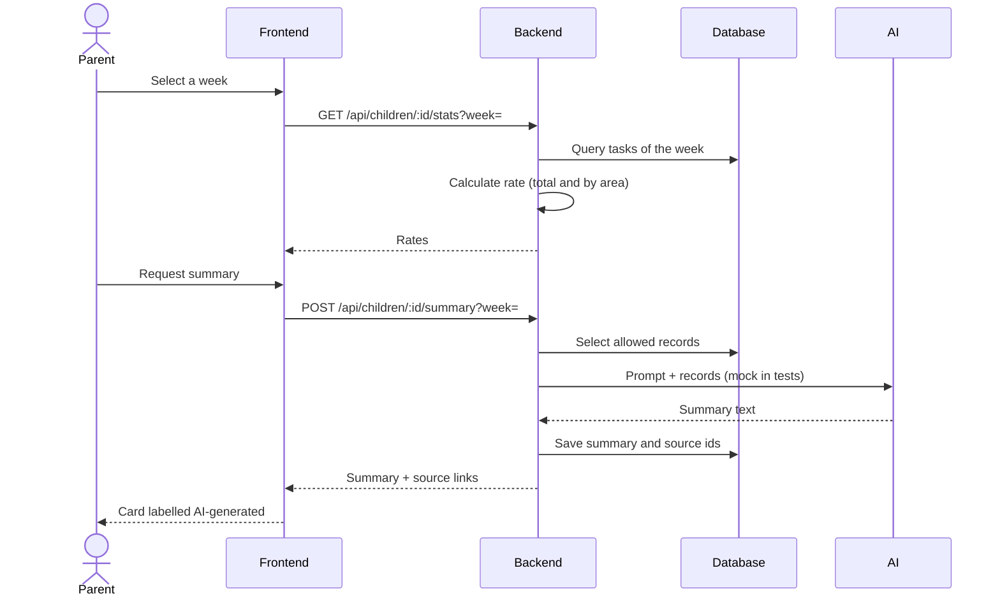

# Software Design Document (SDD)

**Team name:** Kardeşler Software  
**Version:** ☑ First version ☐ Final (Week 6)  
**Last updated:** 2026-10-25

---

## 1. Architecture Overview

The system is a three-tier web application: a React single-page frontend talks to a REST API built with Node.js and Express, which stores data in a SQLite database. The backend is also the only component that talks to the external AI provider. The backend is organized in layers (routes, middleware, services, data access) with one set of components per module.

Main rules that shape the design:

- Identity and permission are separate. The JWT tells the backend **who** the user is; for every request about a child the backend then checks the **current** parent–child ownership or specialist–child link in the database (US-M2-03, NFR-01).
- The AI has one job: summarizing records. Tasks, schedule and statistics are normal application code, and the application works without the AI.
- The AI key lives only in the backend environment. It is never in the frontend or in the repository.

### Technology Stack

| Layer | Technology |
|---|---|
| Frontend | React (Vite), React Router |
| Backend | Node.js, Express, JWT (jsonwebtoken), bcrypt (password hashing), multer (file upload) |
| Database | SQLite (accessed with better-sqlite3), schema and seed script in the repository |
| AI | Gemini API or GitHub Models behind one backend module, with a mock mode |
| Testing | Jest + Supertest (unit and API), Vitest (frontend and unit), Playwright (end-to-end) |
| CI | GitHub Actions |
| Tracking | Jira (key SCRUM), GitHub pull requests |

---

## 2. Module Design

| Module | Main backend components | Main frontend components | Implements |
|---|---|---|---|
| M1 – Login and roles | `AuthController`, `AuthService`, `authenticate` and `requireRole` middleware, `User` model | Login page, role-based router and navigation | US-M1-01 … 05 |
| M2 – Linking specialists | `LinkController`, `LinkService`, `requireChildAccess` middleware, `SpecialistLink` model | Linked specialists page (parent), child list (specialist) | US-M2-01 … 05 |
| M3 – Weekly schedule | `EventController`, `EventService`, `Event` model | WeeklyCalendar, EventForm, upcoming events list (child) | US-M3-01 … 03 |
| M4 – Tasks | `TaskController`, `TaskService`, `Task` model | TaskForm, TaskList (assigner view), MyTasks (child) | US-M4-01 … 03 |
| M5 – Specialist entries | `EntryController`, `EntryService`, `Entry` model | EntryForm, EntryList with "edited" mark | US-M5-01 … 04 |
| M6 – Documents | `DocumentController`, `DocumentService`, upload middleware, `Document` model | DocumentList, upload form | US-M6-01 … 04 |
| M7 – Weekly statistics | `StatsController`, `StatsService` (exact calculation) | WeeklyStats panel on the dashboard | US-M7-01 … 03 |
| M8 – Role-based AI summary | `SummaryController`, `SummaryService`, `AiClient` with `GeminiProvider`, `GithubModelsProvider`, `MockProvider`, prompt builders, `Summary` and `SummaryFeedback` models | SummaryCard with "AI-generated" label, source links and feedback buttons | US-M8-01 … 06 |

---

## 3. Data Model

SQLite stores dates and times as ISO 8601 text. Foreign keys are enabled with `PRAGMA foreign_keys = ON`. Uploaded files are stored in a local folder that is not committed to Git; only metadata is in the database.

**Notes:**
- `UNIQUE(child_id, specialist_id)` on `SPECIALIST_LINK`. Unlinking deletes the row, so the next request from that specialist fails the link check immediately.
- A child's login is a `USER` with role `child`, referenced by `CHILD.user_id` (assumption A2 in the SRS).
- The week of a task is derived from `due_date` (Monday to Sunday, assumption A6).
- Which records a reader may see is not stored; it follows from the role rules in Section 4.2.
- The seed script creates synthetic parents, specialists, children, events, tasks and entries. No real data is used.

---

## 4. API and Access Control

### 4.1 Interfaces

All endpoints are under `/api`, use JSON (except file upload and download) and, apart from login, require a JWT in the `Authorization` header. Logout is handled on the client by discarding the token. `:id` is the child's id.

| Method | Endpoint | Description | Module |
|---|---|---|---|
| POST | `/api/auth/login` | Log in with email and password, receive a token | M1 |
| GET | `/api/auth/me` | Current user and role | M1 |
| GET | `/api/children` | Children visible to the user (own, linked, or own account) | M1, M2 |
| GET | `/api/children/:id/specialists` | List linked specialists | M2 |
| POST | `/api/children/:id/specialists` | Link a registered specialist by email and type | M2 |
| DELETE | `/api/children/:id/specialists/:specialistId` | Unlink a specialist | M2 |
| GET | `/api/children/:id/events?week=` | Events of a week | M3 |
| POST | `/api/children/:id/events` | Add an event | M3 |
| GET | `/api/children/:id/tasks?week=` | Tasks of a week (child: own tasks only) | M4 |
| POST | `/api/children/:id/tasks` | Assign a task | M4 |
| POST | `/api/children/:id/tasks/:taskId/complete` | Child marks a task as done | M4 |
| GET | `/api/children/:id/entries` | List specialist entries | M5 |
| POST | `/api/children/:id/entries` | Add an entry | M5 |
| PUT | `/api/children/:id/entries/:entryId` | Edit an entry, sets "edited" | M5 |
| GET | `/api/children/:id/documents` | List documents | M6 |
| POST | `/api/children/:id/documents` | Upload a PDF or image (multipart) | M6 |
| GET | `/api/children/:id/documents/:docId/download` | Download or view a document | M6 |
| GET | `/api/children/:id/stats?week=` | Completion rate, total and by area | M7 |
| POST | `/api/children/:id/summary?week=` | Generate an AI summary for the caller's role | M8 |
| GET | `/api/children/:id/summary?week=` | Latest summary of the week for the caller's role | M8 |
| POST | `/api/summaries/:summaryId/feedback` | Mark a summary "helpful" or "incorrect" | M8 |

Error responses: `400` invalid data, `401` missing or expired token, `403` not allowed for this role or child, `404` unknown record, `502` AI provider failed (only for M8).

### 4.2 Access rules

Every request about a child passes three steps in the backend: `authenticate` (token valid and not expired), `requireRole` (role allowed for this endpoint) and `requireChildAccess` (a database check on every request, never cached in the token).

| Resource | Parent (owner) | Linked specialist | Child (own account) |
|---|---|---|---|
| Linked specialists | read, link, unlink | none | none |
| Events | read, add | read, add | read |
| Tasks | read, assign | read, assign | read own, mark done |
| Specialist entries | read | read, add, edit own | none |
| Documents | read, upload, download | read, upload, download | none |
| Weekly statistics | read | read | none |
| AI summary | request, feedback | request, feedback | none |

`requireChildAccess` logic: parent → `children.parent_id` equals the user; specialist → a row in `specialist_links` for this child and user exists now; child → `children.user_id` equals the user. Anything else returns `403` and no data about the child. Hiding a button in the frontend is never the only protection.

---

## 5. AI Module

One backend module (`SummaryService` with `AiClient`) is the only place that calls the provider.

Design decisions:

- **Records first, prompt second.** The backend selects only allowed records (the week's tasks with status, and for parent and specialist the entries) and sends only those. A sentence in the prompt such as "do not show restricted data" is not access control.
- **Two prompts.** The parent prompt asks for plain language. The specialist prompt asks for a compact professional overview. Both say: use only the given records; say if information is missing; do not diagnose or suggest treatment.
- **Traceability.** The ids of the records sent are saved in `SUMMARY_SOURCE`, and the frontend shows them as links. The card carries the label "AI-generated" and the buttons "helpful" and "incorrect".
- **Configuration.** `AI_MODE` (`mock` or `live`), `AI_PROVIDER`, `AI_API_KEY` are read from the environment. `.env` is in `.gitignore`; `.env.example` documents the names. Tests and CI always run with `AI_MODE=mock`.
- **Failure handling.** A timeout or provider error returns `502` with a clear message; the rest of the application keeps working.

---

## 6. Critical Flows

### Flow 1: Specialist assigns a task, the child completes it

### Flow 2: Link, unlink and rejected access

### Flow 3: Weekly statistics and AI summary

---

## 7. Requirement to Feature (design questions)

For each module the five design questions from the course are answered. Details of each story are in the SRS.

| Module | Which screen? | Which API operation? | Which data? | Which rule? | Which test? |
|---|---|---|---|---|---|
| M1 | Login page, role-based navigation | `POST /auth/login`, `GET /auth/me` | `USER` | Role comes from the account; token required for all other endpoints | API: wrong password rejected, no token gives 401, wrong role gives 403 · E2E: login per role |
| M2 | Linked specialists page; specialist's child list | `POST` and `DELETE /children/:id/specialists` | `SPECIALIST_LINK`, `USER` | Only the owning parent manages links; unlinked specialist gets 403 on every child request | API: unlinked specialist rejected for each resource · E2E: Flow 2 |
| M3 | Weekly calendar, event form | `GET` and `POST /children/:id/events` | `EVENT` | End after start; specialist must be linked; child may only read own events | Unit: week filter · API: validation and link check · E2E: add and see event |
| M4 | Task form, task list, my tasks | `POST /tasks`, `POST /tasks/:taskId/complete` | `TASK` | Assigner is parent or linked specialist; only the child of the task can mark it done | API: linked succeeds, unlinked rejected, other child rejected · E2E: Flow 1 |
| M5 | Entry form and list | `GET`, `POST`, `PUT /entries` | `ENTRY` | Linked specialist only; edit sets "edited"; child gets 403 | API: edited flag, child rejected · E2E: add and edit entry |
| M6 | Document list and upload form | `GET`, `POST`, download under `/documents` | `DOCUMENT` + file | PDF or image up to 5 MB; child gets 403 | API: type and size rejected, download returns same bytes · E2E: upload and download |
| M7 | Statistics panel on the dashboard | `GET /stats?week=` | `TASK` | Rate = done / total of the week, computed in code; no tasks shows no rate | Unit: 3 of 5 gives 60%, empty week · API: link check · E2E: Flow 3 |
| M8 | Summary card | `POST` and `GET /summary`, `POST /feedback` | `SUMMARY`, `SUMMARY_SOURCE`, `SUMMARY_FEEDBACK` | Only allowed records sent; label and sources shown; no diagnosis; key only on backend | Unit: prompt builders, only-allowed-records · API: mock mode, provider failure gives 502 · E2E: Flow 3 |

Test levels and targets: unit tests (Jest, Vitest) for calculations and prompt building; API tests (Jest + Supertest) for access rules and validation; Playwright end-to-end tests for the 3 critical flows at v0.2 and for each of M1–M8 at v1.0. Branch coverage ≥ 40% at v0.2 and ≥ 60% at v1.0.

---

## 8. User Interface

The interface follows the example screens of the assignment (Appendix A); the team may change the design. Screenshots are added to `docs/img/` when the screens are implemented.

| Screen | Image | Module |
|---|---|---|
| Login | `docs/img/ui-login.png` (add at v0.1) | M1 |
| Parent: weekly dashboard (schedule, tasks, statistics, AI summary) | `docs/img/ui-parent-dashboard.png` (add at v0.2) | M3, M4, M7, M8 |
| Parent: linked specialists | `docs/img/ui-linked-specialists.png` (add at v0.1) | M2 |
| Child: my tasks and upcoming events | `docs/img/ui-child-tasks.png` (add at v0.1) | M1, M3, M4 |
| Specialist: child profile and new entry | `docs/img/ui-specialist-child.png` (add at v0.2) | M2, M5, M8 |
| Specialist: assign and track tasks | `docs/img/ui-task-assign.png` (add at v0.1) | M4 |
| Documents | `docs/img/ui-documents.png` (add at v0.2) | M6 |

---

## 9. Running and Configuration

The application must install and run locally by following the README (a release that cannot be installed this way is not accepted). The README will list: install steps, running the seed script, starting backend and frontend, the standard test commands, and the environment variables (`JWT_SECRET`, `AI_MODE`, `AI_PROVIDER`, `AI_API_KEY`), with `.env.example` as a template. The current README is a placeholder and is completed with the walking skeleton (v0.0).

---

## 10. Change Log

| Date | Change | By |
|---|---|---|
| 2026-10-22 | First version (child growth tracking concept, PostgreSQL) | Kardeşler Software |
| 2026-10-25 | Rewritten to match the Term Project Assignment: SQLite, roles parent/specialist/child, modules M1–M8, access rules, AI module with mock mode | Kardeşler Software |
