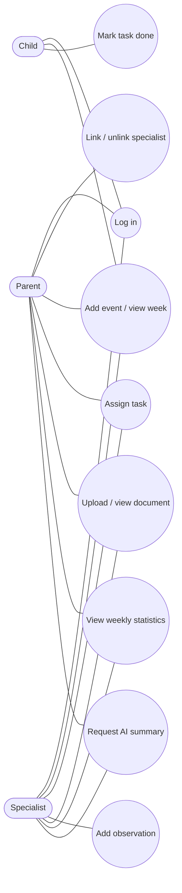

# Software Requirements Specification (SRS)

**Team name:** Kardeşler Software  
**Version:** ☑ Draft (Week 4) ☐ Final (Week 6)  
**Last updated:** 2026-10-25

---

## 1. Introduction

### 1.1 Purpose of the system

A child's development is followed by many people at once: parents, teachers, psychologists, doctors, special education teachers and coaches. Each of them keeps their own notes and sees only part of the picture. The AI-Assisted Child Development Platform is a **web-based decision support platform** that brings these people together around one shared schedule, task list and record of observations. An AI component summarizes the week's records for each reader according to their role.

**The AI supports decisions; it never makes them.** Every AI summary is shown as a suggestion, labelled "AI-generated", with the records it is based on. A human decides.

### 1.2 Users of the system

| User type | Description |
|---|---|
| Parent | Owns the child's data and sees all records. Links and unlinks specialists. Adds events and tasks, uploads documents, views statistics and the AI summary. |
| Specialist | Teacher, psychologist, doctor, special education teacher or coach. Works only with the children they are linked to: adds events, tasks, dated observations and documents, and views the AI summary. |
| Child | Sees only their own tasks and schedule and marks tasks as done. Cannot see specialist entries or documents. |

### 1.3 Constraints

| Area | Constraint |
|---|---|
| Technology | React (Vite), Node.js + Express, SQLite, JWT authentication. Tests: Jest + Supertest, Vitest, Playwright. CI: GitHub Actions. Work tracking: Jira. |
| AI | Gemini API or GitHub Models (team choice, see Section 8), accessed through one backend module with a mandatory mock mode for tests and CI. |
| Data | Only synthetic data, created by a seed script. No real personal data at any stage. |
| Safety | The AI never makes decisions or suggests a diagnosis or treatment, and receives only data the reader is allowed to see. |
| Running | The application runs locally by following the README. No cloud deployment. |

### 1.4 Out of scope

Field-level permissions, email invitations, an admin panel, mobile apps, cloud deployment, microservices and Docker. Optional extensions (monthly views, recurring tasks, edit history, per-document sharing, AI task suggestions, notifications) are only considered after all eight requirements pass the test team's tests.

### 1.5 Terms

| Term | Meaning |
|---|---|
| Linked specialist | A specialist account that the parent has linked to a given child and has not unlinked. |
| Development area | One of: Language, Motor, Social, Cognitive, Emotional (assumption A4, Section 8). |
| Source records | The tasks, completion statuses and observations that an AI summary is based on. |

---

## 2. Functional Requirements as User Stories

Priority is **Must** for all requirements below, since the assignment makes M1–M8 mandatory. "Release" is the version in which the requirement must work.

### M1 – Login and roles (v0.1)

| ID | User story | Acceptance criteria |
|---|---|---|
| US-M1-01 | As a user, I want to log in with my email and password so that I can use the platform. | **Given** a registered account **When** the user submits the correct email and password **Then** the user is logged in and sees the screens of their own role. **Given** a wrong password or unknown email **When** the user submits the form **Then** login is rejected with a clear error and no token is issued. |
| US-M1-02 | As a user, I want each role to see only its own screens so that I am not confused by, or exposed to, functions that are not mine. | **Given** a logged-in child **When** the child opens a parent or specialist screen address **Then** access is denied and the child is redirected to their own screen. **Given** a logged-in user **When** the role is shown or used **Then** it comes from the account and the user cannot choose it at login. |
| US-M1-03 | As the system owner, I want the API to reject unauthorized requests so that hiding a button is not the only protection. | **Given** a request without a valid token **When** it reaches any protected endpoint **Then** the API returns 401. **Given** a valid token of the wrong role **When** it reaches a role-restricted endpoint **Then** the API returns 403. |
| US-M1-04 | As a user, I want my password stored securely and my session to expire so that my account is protected. | **Given** a stored account **When** the database is inspected **Then** the password is stored only as a hash. **Given** an expired token **When** it is used **Then** the API returns 401. |
| US-M1-05 | As a user, I want to log out so that nobody else can use my session on this device. | **Given** a logged-in user **When** the user logs out **Then** the token is discarded on the client and protected screens are no longer accessible. |

### M2 – Linking specialists (v0.1)

| ID | User story | Acceptance criteria |
|---|---|---|
| US-M2-01 | As a parent, I want to link a registered specialist to my child by email and type so that the specialist can work with my child. | **Given** a registered specialist account **When** the parent enters its email and a specialist type **Then** the specialist appears in the parent's list of linked specialists for that child. **Given** an email with no registered specialist account **When** the parent submits it **Then** an error is shown and no link is created. |
| US-M2-02 | As a parent, I want to see the specialists linked to my child so that I know who can access the data. | **Given** a parent with linked specialists **When** the parent opens the linked specialists screen **Then** each linked specialist is listed with name, email and type. |
| US-M2-03 | As a parent, I want to unlink a specialist so that they no longer see my child's data. | **Given** a linked specialist **When** the parent unlinks the specialist and confirms **Then** the link is removed from the list. **Given** an unlinked specialist with a still valid token **When** the specialist sends any API request about the child (events, tasks, entries, documents, statistics, summary) **Then** the API returns an error and no data about the child. |
| US-M2-04 | As a specialist, I want to see the list of children linked to me so that I can choose whom to work with. | **Given** a specialist linked to two children **When** the specialist opens the child list **Then** exactly those two children are shown and no others. |
| US-M2-05 | As a parent, I want only my own children's links to be manageable by me so that other families are not affected. | **Given** a parent who does not own a child **When** the parent sends a link or unlink request for that child **Then** the API rejects the request. |

### M3 – Weekly schedule (v0.1)

| ID | User story | Acceptance criteria |
|---|---|---|
| US-M3-01 | As a parent or linked specialist, I want to add an event for a child so that everyone sees the schedule. | **Given** a parent or a linked specialist **When** they submit an event with title, date, start and end time **Then** the event is saved and appears in the weekly view of that child. **Given** an end time before the start time or a missing title **When** the form is submitted **Then** the event is rejected with a validation message. |
| US-M3-02 | As a parent or linked specialist, I want to see a child's events in a weekly view so that I can see what is planned. | **Given** a child with events in different weeks **When** a week is selected **Then** only events of that week are listed, ordered by date and time. **Given** a specialist who is not linked to the child **When** the specialist requests the child's events **Then** the API rejects the request. |
| US-M3-03 | As a child, I want to see my upcoming events so that I know what is coming. | **Given** a logged-in child **When** the child opens their screen **Then** upcoming events of their own schedule are shown and no other child's events. |

### M4 – Tasks (v0.1)

| ID | User story | Acceptance criteria |
|---|---|---|
| US-M4-01 | As a parent or linked specialist, I want to assign a task to a child so that the child knows what to do. | **Given** a parent or a linked specialist **When** they submit a task with title, description, development area and due date **Then** the task is saved with status "pending" and the assigner recorded. **Given** a specialist who is not linked to the child **When** the specialist submits a task for the child **Then** the API rejects the request and nothing is saved. **Given** a missing title or invalid due date **When** the form is submitted **Then** the task is rejected with a validation message. |
| US-M4-02 | As a child, I want to see my tasks and mark them as done so that my helpers see my progress. | **Given** a logged-in child with tasks **When** the child opens "my tasks" **Then** only their own tasks are shown. **Given** a pending task of the child **When** the child marks it as done **Then** its status becomes "done". **Given** a task of another child **When** the child tries to mark it as done through the API **Then** the request is rejected. |
| US-M4-03 | As an assigner (parent or specialist), I want to see the status of the tasks I assigned so that I can follow up. | **Given** a task assigned by a user **When** the child marks it as done **Then** the assigner sees the status "done" in their task list. |

### M5 – Specialist entries (v0.2)

| ID | User story | Acceptance criteria |
|---|---|---|
| US-M5-01 | As a linked specialist, I want to add a dated observation about a child so that the child's record grows over time. | **Given** a linked specialist **When** the specialist submits an observation with a date and text **Then** it is saved with the specialist's name and appears in the child's entry list. **Given** a specialist who is not linked **When** the specialist submits an observation **Then** the API rejects the request. |
| US-M5-02 | As a linked specialist, I want to edit my own entry and have the edit visible so that readers know it changed. | **Given** an entry written by the specialist **When** the specialist edits it **Then** the new text is saved and the entry is marked "edited". **Given** an entry written by another specialist **When** this specialist tries to edit it **Then** the API rejects the request. |
| US-M5-03 | As a parent or linked specialist, I want to read the child's entries so that I see the whole picture. | **Given** a child with entries **When** the parent or a linked specialist opens the entries **Then** all entries are listed with date, author and "edited" mark where applicable. |
| US-M5-04 | As a parent, I want entries hidden from the child so that the child only sees their own tasks and schedule. | **Given** a logged-in child **When** the child requests entries through the screen or the API **Then** access is denied and no entry is returned. |

### M6 – Documents (v0.2)

| ID | User story | Acceptance criteria |
|---|---|---|
| US-M6-01 | As a parent or linked specialist, I want to upload a PDF or image for a child so that reports and photos are in one place. | **Given** a PDF or image file within the size limit (assumption A5) **When** it is uploaded **Then** it is stored and appears in the document list. **Given** a file of another type or over the size limit **When** it is uploaded **Then** it is rejected with a clear message and nothing is stored. |
| US-M6-02 | As a parent or linked specialist, I want to list documents with name, type, uploader and date so that I can find the right one. | **Given** uploaded documents **When** the list is opened **Then** each document shows file name, type, uploader and upload date. |
| US-M6-03 | As a parent or linked specialist, I want to view and download a document so that I can read it. | **Given** a listed document **When** the user opens or downloads it **Then** the file content is returned unchanged. **Given** a specialist who is not linked **When** the specialist requests the document **Then** the API rejects the request. |
| US-M6-04 | As a parent, I want documents hidden from the child. | **Given** a logged-in child **When** the child requests the document list or a file **Then** access is denied. |

### M7 – Weekly statistics (v0.2)

| ID | User story | Acceptance criteria |
|---|---|---|
| US-M7-01 | As a parent or linked specialist, I want the task completion rate for a selected week so that I see how the child is doing. | **Given** a week with 5 tasks of which 3 are done **When** that week is selected **Then** the completion rate is 60%. **Given** a week with no tasks **When** it is selected **Then** the screen shows that there are no tasks instead of a rate. |
| US-M7-02 | As a parent or linked specialist, I want the rate split by development area so that I see where the child is doing well or needs support. | **Given** tasks in several development areas **When** a week is selected **Then** the rate is shown in total and for each area that has tasks. **Given** the same data **When** the calculation is run in a unit test **Then** the result is computed by application code, not by the AI. |
| US-M7-03 | As a user, I want statistics only for children I may see. | **Given** a specialist who is not linked **When** the specialist requests statistics for the child **Then** the API rejects the request. |

### M8 – Role-based AI summary (v0.2)

| ID | User story | Acceptance criteria |
|---|---|---|
| US-M8-01 | As a parent, I want a plain-language summary of the child's week so that I understand it quickly. | **Given** a week with tasks and observations **When** the parent requests a summary **Then** a summary is shown that is based on the week's records the parent may see, uses the parent prompt, and states if information is missing. |
| US-M8-02 | As a linked specialist, I want a summary written for specialists so that I can review the records efficiently. | **Given** the same week **When** a linked specialist requests a summary **Then** the specialist prompt is used and only records the specialist may see are sent to the AI. |
| US-M8-03 | As a reader, I want the summary clearly labelled and traceable so that I can judge it. | **Given** a displayed summary **When** the screen is rendered **Then** it carries the label "AI-generated" and links to the source records it is based on. **Given** a displayed summary **When** the reader marks it "helpful" or "incorrect" **Then** the feedback is saved. |
| US-M8-04 | As the system owner, I want the AI to support but never replace human decisions. | **Given** any summary **When** it is generated **Then** the prompt forbids diagnosis and treatment suggestions, and the summary is presented as a suggestion only. |
| US-M8-05 | As a developer, I want a mock mode so that tests and CI do not depend on an external service. | **Given** mock mode is on **When** a summary is requested **Then** a controlled sample answer is returned without calling the provider. **Given** the AI provider is unavailable or the key is missing **When** a summary is requested **Then** a clear error message is shown and the rest of the application still works. |
| US-M8-06 | As the system owner, I want the AI key protected. | **Given** the repository and the frontend code **When** they are inspected **Then** the API key is in neither; it is read only by the backend from the environment. |

---

## 3. Non-Functional Requirements

| ID | Category | Requirement |
|---|---|---|
| NFR-01 | Security | Access rules are enforced in the backend for every request about a child: the backend checks the token and then the current parent–child ownership or specialist–child link, not only the user's role. |
| NFR-02 | Security | Passwords are stored hashed. Tokens expire and contain no passwords or child records. |
| NFR-03 | Privacy | Only synthetic data created by a seed script is used. The AI receives only records the reader is allowed to see. |
| NFR-04 | AI safety | The AI never diagnoses or suggests treatment. Restricted data is never sent in the prompt; the prompt text is not used as access control. |
| NFR-05 | Testability | Unit, API and end-to-end tests exist for the requirements. Branch coverage is at least 40% at v0.2 and 60% at v1.0. AI calls are replaceable by a mock. |
| NFR-06 | Portability | The application installs and runs locally by following the README. A release that cannot be installed this way is not accepted. |
| NFR-07 | Usability | A user can complete the main action of their role (parent: add a task; specialist: add an entry; child: mark a task done) without help. |
| NFR-08 | Maintainability | All changes go through reviewed pull requests with the Jira issue key in the commit message and branch name; CI runs automatically on every change. |

---

## 4. Critical Flows and Acceptance Criteria

These three flows are covered by end-to-end tests at v0.2.

| Flow | Related requirements | Acceptance criteria |
|---|---|---|
| Flow 1: Specialist assigns a task and the child completes it | US-M1-01, US-M2-01, US-M4-01, US-M4-02, US-M4-03 | **Given** a parent who has linked a specialist to their child **When** the specialist logs in and creates the task "Read for 20 minutes" for the child, the child logs in and marks it as done **Then** the specialist sees the status "done" in their task list. |
| Flow 2: Link, unlink and rejected access | US-M2-01, US-M2-03, US-M4-01 | **Given** a linked specialist **When** the parent unlinks the specialist and the specialist then tries to read the child's data or assign a task (even with a still valid token) **Then** the API returns an error and no data about the child is exposed. |
| Flow 3: Weekly statistics and AI summary | US-M7-01, US-M7-02, US-M8-01, US-M8-03 | **Given** a child with tasks and observations in one week **When** the parent selects that week and requests the AI summary (mock mode in tests) **Then** the completion rate in total and by area and a summary labelled "AI-generated" with links to its source records are shown. |

---

## 5. Use Case Diagram

The child's use of "Add event / view week" is limited to viewing their own upcoming events.

---

## 6. Release Plan

| Release | Week | Requirements | Other criteria |
|---|---|---|---|
| v0.0 (walking skeleton) | 5 | One small action end to end (a sample task from SQLite through Express to React) | Repository, CI and Jira set up |
| v0.1 | 8 | M1–M4 | First end-to-end test running in CI |
| v0.2 | 10 | M1–M8 | Branch coverage ≥ 40%, end-to-end tests for the 3 critical flows |
| v1.0 | 12 | M1–M8 | Branch coverage ≥ 60%, an end-to-end test for each of M1–M8, final report |

---

## 7. Traceability to Design and Tests

For every requirement the team answers five questions in the design document (SDD) and the test plan: which screen, which API operation, which data, which rule, which test. Example for US-M4-01: task creation form · create a new task · child, assigning user, title, area, date, status · the specialist must be linked to the child · a linked specialist succeeds, an unlinked specialist is rejected.

---

## 8. Assumptions and Open Questions

| # | Item | Status |
|---|---|---|
| A1 | Parent and specialist accounts are created by the seed script; self-registration and email invitations are not required. | Assumption, confirm with instructor |
| A2 | The parent creates the child's profile and the child's login account (name, email, password). | Assumption |
| A3 | A specialist's "type" is one of: teacher, psychologist, doctor, special education teacher, coach. | Assumption |
| A4 | Development areas: Language, Motor, Social, Cognitive, Emotional. | Assumption |
| A5 | Uploaded documents: PDF or image (PNG/JPEG), up to 5 MB each. | Assumption |
| A6 | A week runs Monday to Sunday and a task belongs to the week of its due date. | Assumption |
| A7 | AI provider (Gemini API or GitHub Models) | **Open: team decision** |
| A8 | Interface language (Turkish or English) | **Open: team decision** |

---

## 9. Change Log

| Date | Change | By |
|---|---|---|
| 2026-10-22 | First version (child growth tracking concept) | Kardeşler Software |
| 2026-10-25 | Rewritten to match the Term Project Assignment: roles parent/specialist/child, modules M1–M8, SQLite, AI summary, release plan | Kardeşler Software |
