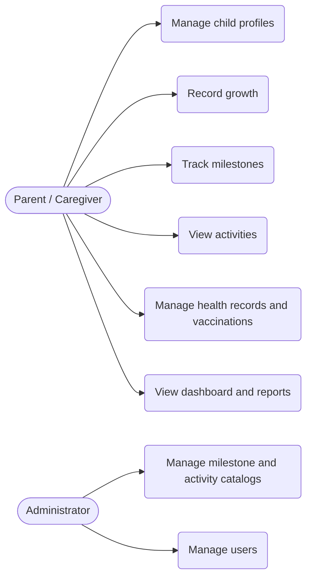

# Software Requirements Specification (SRS)

**Team name:** Kardeşler Software  
**Version:** ☑ First version (Week 6) ☐ Final (Week 10)  
**Last updated:** 2026-10-22

---

## 1. Introduction

**Purpose of the system:**  
The Child Development Platform is a web application that lets parents and caregivers record and follow a child's growth, developmental milestones, health records and daily activities. It gives age-appropriate activity suggestions and reminders so that families can support healthy development and share clear information with pediatric professionals.

**Users of the system:**

| User type | Description |
|---|---|
| Parent / Caregiver | Registers one or more children, enters growth, milestone and health data, and follows suggestions and reminders. |
| Administrator | Manages the milestone and activity catalogs and user accounts. |

---

## 2. Functional Requirements

### M1 – Authentication & User Accounts

| ID | Requirement | Priority |
|---|---|---|
| FR-M1-01 | The system shall allow a new user to register with name, email and password. | Must |
| FR-M1-02 | The system shall allow a registered user to log in and log out. | Must |
| FR-M1-03 | The system shall store passwords in hashed form. | Must |
| FR-M1-04 | The system shall allow a user to edit their profile information. | Should |
| FR-M1-05 | The system shall allow a user to reset a forgotten password by email. | Could |
| FR-M1-06 | The system shall restrict administrator functions to users with the Administrator role. | Must |

### M2 – Child Profiles

| ID | Requirement | Priority |
|---|---|---|
| FR-M2-01 | The system shall allow a parent to create a child profile with name, date of birth and gender. | Must |
| FR-M2-02 | The system shall allow a parent to view a list of their own children. | Must |
| FR-M2-03 | The system shall allow a parent to edit a child profile. | Must |
| FR-M2-04 | The system shall allow a parent to delete a child profile and its related data. | Should |
| FR-M2-05 | The system shall prevent a user from accessing child profiles that belong to other users. | Must |

### M3 – Growth Tracking

| ID | Requirement | Priority |
|---|---|---|
| FR-M3-01 | The system shall allow a parent to add a growth entry (date, height, weight, head circumference) for a child. | Must |
| FR-M3-02 | The system shall validate that growth values are positive numbers within realistic ranges. | Must |
| FR-M3-03 | The system shall display a child's growth history as a table and as a chart. | Must |
| FR-M3-04 | The system shall allow a parent to edit or delete a growth entry. | Should |
| FR-M3-05 | The system shall compare a child's measurements with reference growth percentiles. | Could |
| FR-M3-06 | The system shall calculate and show the child's current age from the date of birth. | Should |

### M4 – Developmental Milestones

| ID | Requirement | Priority |
|---|---|---|
| FR-M4-01 | The system shall provide a catalog of developmental milestones grouped by age range and area (motor, language, social, cognitive). | Must |
| FR-M4-02 | The system shall allow a parent to mark a milestone as achieved with the date. | Must |
| FR-M4-03 | The system shall show milestones that are due for the child's current age. | Must |
| FR-M4-04 | The system shall show the milestone completion progress per development area. | Should |
| FR-M4-05 | The system shall allow an administrator to add, edit and remove milestones in the catalog. | Should |
| FR-M4-06 | The system shall allow a parent to add a note to a milestone. | Could |

### M5 – Activities & Recommendations

| ID | Requirement | Priority |
|---|---|---|
| FR-M5-01 | The system shall provide a catalog of activities with title, description, age range and development area. | Must |
| FR-M5-02 | The system shall suggest activities that match the child's current age. | Must |
| FR-M5-03 | The system shall allow a parent to mark an activity as completed. | Should |
| FR-M5-04 | The system shall allow a parent to filter activities by development area. | Should |
| FR-M5-05 | The system shall allow an administrator to manage the activity catalog. | Should |

### M6 – Health Records & Vaccinations

| ID | Requirement | Priority |
|---|---|---|
| FR-M6-01 | The system shall allow a parent to add a health record (date, type, description, doctor) for a child. | Must |
| FR-M6-02 | The system shall provide a standard vaccination schedule by age. | Must |
| FR-M6-03 | The system shall allow a parent to mark a vaccination as done with the date. | Must |
| FR-M6-04 | The system shall show which vaccinations are upcoming or overdue. | Must |
| FR-M6-05 | The system shall allow a parent to record allergies and chronic conditions for a child. | Should |
| FR-M6-06 | The system shall allow a parent to edit or delete a health record. | Should |

### M7 – Reminders & Notifications

| ID | Requirement | Priority |
|---|---|---|
| FR-M7-01 | The system shall remind a parent of upcoming vaccinations. | Must |
| FR-M7-02 | The system shall allow a parent to create a reminder for a doctor visit or checkup. | Should |
| FR-M7-03 | The system shall show active reminders in an in-app notification list. | Must |
| FR-M7-04 | The system shall send reminder emails if the user has enabled email notifications. | Could |

### M8 – Dashboard & Reports

| ID | Requirement | Priority |
|---|---|---|
| FR-M8-01 | The system shall show a dashboard for each child with the latest growth, upcoming milestones, vaccinations and reminders. | Must |
| FR-M8-02 | The system shall allow a parent to generate a summary report of a child's growth, milestones and health records. | Should |
| FR-M8-03 | The system shall allow a parent to export the report as a PDF. | Could |
| FR-M8-04 | The system shall allow a parent to select a date range for the report. | Could |
| FR-M8-05 | The system shall show an administrator the total number of users and children registered. | Could |

---

## 3. Non-Functional Requirements

| ID | Category | Requirement |
|---|---|---|
| NFR-01 | Performance | Main pages shall load in under 2 seconds under normal load (up to 50 concurrent users). |
| NFR-02 | Security | Passwords shall be stored hashed, and every API request for child data shall verify that the child belongs to the logged-in user. |
| NFR-03 | Privacy | Child data shall only be visible to the owning parent account and shall not be shared with third parties. |
| NFR-04 | Usability | A new user shall be able to register and add a first child within 3 minutes without help. |
| NFR-05 | Compatibility | The web interface shall work on current versions of Chrome, Firefox and Edge, and on mobile screen sizes. |

---

## 4. Critical Flows and Acceptance Criteria

| Flow | Related requirements | Acceptance criteria |
|---|---|---|
| Flow 1: Register, log in and add a child | FR-M1-01, FR-M1-02, FR-M2-01, FR-M2-02 | **Given** a visitor without an account **When** they register, log in and submit the child form with valid data **Then** the child appears in their child list. |
| Flow 2: Record a growth measurement | FR-M3-01, FR-M3-02, FR-M3-03 | **Given** a logged-in parent with a child profile **When** they submit a growth entry with valid height and weight **Then** the entry is saved and appears in the growth table and chart. |
| Flow 3: Track a vaccination | FR-M6-02, FR-M6-03, FR-M6-04 | **Given** a logged-in parent with a child who has a due vaccination **When** they mark the vaccination as done **Then** it is shown as completed and no longer appears as upcoming or overdue. |

---

## 5. Use Case Diagram (optional)

---

## 6. Change Log

| Date | Change | By |
|---|---|---|
| 2026-10-22 | First version | Kardeşler Software |
